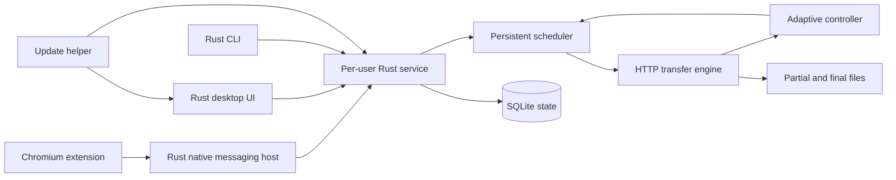

# Implementation plan

Prepared 2026-11-17. Proposed design, not implemented behavior.

The accompanying [technical design](technical-design.md) specifies component
interfaces, data models, algorithms, recovery protocols, and verification gates
for these milestones.

## 1. Product scope and assumptions

Build a local-first download manager with a Rust engine that improves throughput
under changing network conditions while preserving correctness, responsiveness,
and user limits. No account or cloud service is required. Updates use a release
repository; download URLs, cookies, and history stay on the user's machine.

The first release includes:

- HTTP/HTTPS downloads, pause/resume, restart recovery, retries, and integrity checks.
- Automatic tuning of range concurrency and work allocation; manual limits always win.
- FIFO scheduling, explicit priorities, queue reordering, and a configurable maximum
  number of active downloads. Sequential mode means exactly one active file;
  that file may still use multiple ranges unless the user selects one stream.
- A persistent per-user service, CLI, Rust desktop UI, and Chromium extension.
- Component-selecting installers and automatic native updates without manual
  archive extraction or repeated package downloads by the user.
- At least 90% unit-test line coverage, supplemented by real protocol, browser,
  installation, and recovery tests.

Initial qualification targets: Ubuntu 22.04/24.04/26.04 and Debian 12/13 on x86_64;
macOS 13+ on Intel and Apple Silicon; Windows 11 x64. These are proposed minimums
to validate against GUI/toolchain dependencies in the first milestone. Linux
ARM64 is a follow-up unless CI and packaging validate it during the first release.
Keep all three operating systems in CI from the beginning. Qualify Chrome first,
then Edge, Brave, and native Chromium builds. Test Snap/Flatpak browser integration
separately because sandbox packaging may change host discovery and access.

Defer torrents, FTP/SFTP, DRM/media extraction, cloud sync, arbitrary native plugins,
remote administration, HTTP/3, and multi-interface bonding. Here, “plugin” means
the browser extension. These exclusions keep the first release achievable.

## 2. Architecture and technology choices



All native executables and business logic use Rust. Use a thin TypeScript
Manifest V3 extension because Chromium APIs require JavaScript integration;
shipping the native engine as extension WASM would not remove browser restrictions.

| Area | Proposed choice | Reason / validation requirement |
| --- | --- | --- |
| Runtime | Tokio | Async I/O, timers, cancellation, bounded tasks |
| HTTP | reqwest with rustls, HTTP/1.1 and HTTP/2 | Reusable clients; inspect range, proxy, redirect, and decoding behavior |
| Desktop | Iced | Rust UI; validate accessibility, IME, scaling, renderer fallback early |
| Persistence | SQLite through rusqlite, dedicated DB worker | Transactions and migrations without blocking the async runtime |
| IPC | Versioned, length-framed JSON over local sockets/pipes | Simple diagnostics and shared typed protocol |
| CLI / data / errors | clap, serde, thiserror | Typed input and explicit recoverable errors |
| Diagnostics | tracing with rotating, redacted logs | Local troubleshooting without credentials in logs |
| Updates | TUF metadata using a maintained Rust client, initially evaluate tough | Existing trust protocol rather than custom signature design |
| Testing | cargo-llvm-cov, proptest, deterministic clocks, local HTTP fixtures | Unit coverage plus fault injection |

Dependency versions will be selected and pinned in Cargo.lock during scaffolding,
with a pinned Rust toolchain/MSRV policy. Do not hard-code version guesses into
the plan. reqwest documents asynchronous clients and connection reuse; Iced
provides a Rust cross-platform GUI. [HTTP client documentation](https://docs.rs/reqwest/latest/reqwest/),
[Iced project](https://github.com/iced-rs/iced).

Proposed workspace, introduced incrementally rather than as empty crates:

```text
crates/
  domain/          # jobs, settings, state transitions, errors
  engine/          # HTTP transport, ranges, disk pipeline, verification
  scheduler/       # admission, fairness, retry timing, bandwidth budgets
  adaptive/        # pure sampling and tuning decisions
  storage/         # database, migrations, recovery journal
  protocol/        # versioned IPC commands, events, capability negotiation
  platform/        # OS paths, local IPC, lifecycle, credential storage
  updater/         # metadata verification and update state machine
apps/
  service/         # download-managerd
  cli/             # downloadctl
  desktop/         # Iced application
  native-host/     # Chromium native messaging bridge
  update-helper/   # staged replacement and rollback
extensions/chromium/
installers/{linux,macos,windows}/
tests/{fixtures,e2e}/
benchmarks/
docs/{adr,testing,releases}/
```

Library crates contain decisions and state machines; binaries remain thin. UI
clients never mutate the database or downloaded files directly. The service
owns the queue and enforces limits even if clients disconnect or disagree.

Unix sockets use a user-only runtime directory; Windows named pipes use a
current-user ACL. Validate peer identity where supported. No default TCP listener.
Messages have size limits, request IDs, protocol versions, capability negotiation,
idempotency keys, and structured errors. Streaming events carry sequence numbers;
clients request a fresh snapshot after reconnect or missed events. Support a
defined previous protocol version so independent extension updates remain usable.

## 3. Correct transfer engine before adaptive tuning

Model job states explicitly: queued, probing, downloading, retry-wait, paused,
verifying, completed, failed, canceled, and needs-authentication. Define permitted
transitions and the meaning of durable completion in unit-tested library code.

HTTP behavior follows range and validator semantics in
[RFC 9110](https://www.rfc-editor.org/rfc/rfc9110.html): validate actual 206 responses
and Content-Range rather than trusting Accept-Ranges alone. Handle ignored ranges
(200), unsatisfiable ranges (416), redirects, changing representations, and
unknown lengths. Use a strong validator for safe parallel assembly/resume; treat
unverifiable representations conservatively. Disable transparent decoding for
byte-range assembly and request identity encoding. Never mix ranges from different
representations. Honor Retry-After and distinguish retryable failures from terminal
errors. Scope authorization to its origin across redirects.

Implementation requirements:

1. Establish a streaming single-request implementation with bounded memory first.
   Handle empty files, chunked bodies, slow headers/bodies, truncated responses,
   proxy settings, TLS failures, and cancellation.
2. Probe cautiously. HEAD is optional, since some servers handle it incorrectly.
   Reuse an initial GET where possible; do not issue extra probes for known
   one-time URLs. If safe replay cannot be established, retain a single stream.
3. Track disjoint byte intervals and assign each interval to one worker. Use
   platform positioned writes or a bounded writer pipeline. Preallocation is
   optional and must handle unsupported filesystems and out-of-space errors.
4. Store partial files in the destination filesystem. Flush file data before
   committing completed intervals; on recovery revalidate uncertain intervals.
   Do not claim a database transaction makes filesystem writes atomic.
5. Complete only after interval coverage and length checks, optional expected
   digest verification, flush, and collision-safe finalization. A locally computed
   digest alone is not evidence that the server provided the intended content.
6. Make completion recovery idempotent across the file rename/database boundary.
   Reject path traversal, unsafe server filenames, reserved names, and symlink
   escapes; never overwrite an existing file silently.
7. Persist configuration, queue order, retry deadlines, validators, and checkpoints.
   Serialize database operations and avoid a transaction per received chunk.

Default credentials are ephemeral. Optional resumable authenticated sessions use
OS credential storage; protect sensitive URLs at rest as well. If secure storage
is unavailable, request authentication again after restart instead of silently
storing tokens in plaintext. Incognito downloads are opt-in and avoid persistent
history and credentials.

## 4. Scheduling and adaptive performance

Optimize useful bytes written per second within resource limits; do not promise
to exceed the user's link capacity or always outperform a single stream. The
controller adjusts application concurrency, not the operating system TCP algorithm.

Keep three independent budgets: active files, active ranges per file, and total
requests per origin/global. HTTP/2 streams are not the same as TCP connections.
Start with a maximum of three active files, one initial range per file, an automatic
ceiling of eight ranges per file, eight active requests per origin, and 24 globally.
These are provisional benchmark inputs, not proven optimal settings.

Use FIFO within priority classes, aging to avoid starvation, and per-origin
fairness. User changes to limits take effect without losing progress. Lowering the
active-file limit checkpoints and pauses excess jobs at safe boundaries; the UI
shows the transition. A global token bucket enforces a user bandwidth cap.

Adaptive loop:

1. Sample at roughly one-second intervals: useful throughput, per-request progress,
   time-to-first-byte, stalls, timeout/error rate, server throttling, active streams,
   disk queue latency, memory pressure, and retry waste. TTFB is a proxy signal,
   not a direct measurement of RTT or packet loss.
2. Smooth observations and require a warm-up window. For sufficiently large,
   range-capable files, add one range after a stable observation window (initially
   five seconds), holding other knobs steady.
3. Keep the change only if goodput improves materially (initially 5%) without a
   harmful increase in latency, errors, or disk pressure. Otherwise revert and
   enter a cooldown (initially 15 seconds). Thresholds become benchmarked settings.
4. On 429/503, timeouts, or pressure, reduce concurrency promptly, honor server
   cooldowns, and use bounded exponential retry backoff with jitter. Avoid retries
   across all workers firing together.
5. Size future range work to a target duration, initially 2–5 seconds with 1–32 MiB
   clamps. Do not restart healthy in-flight ranges merely to resize chunks. Tiny
   files remain single-stream.
6. Reallocate spare budget across active files. Optional automatic active-file
   tuning stays below the user's configured maximum and runs on a slower timescale;
   sequential mode never admits a second file.
7. Reset stale observations after sleep/wake, interface/VPN/proxy changes, or long
   stalls. Keep only short-lived, privacy-preserving per-origin hints. Unknown
   metered-network status uses a conservative default with a user override.

Ship automatic, conservative, and manual modes. Automatic is the eventual default;
retain a fixed-concurrency baseline and feature switch during tuning rollout.
No background speed tests or unrelated probe traffic are required.

## 5. Chromium download capture

Use Manifest V3, the downloads API, and a Rust native messaging host. Native
messaging is an explicitly registered channel between extension and application;
the host forwards control messages, never downloaded file bytes.
[Chrome native messaging](https://developer.chrome.com/docs/extensions/develop/concepts/native-messaging).

Provide “Download with Download Manager” in the context menu first, then automatic
capture with per-site exclusions, size/type rules, and an easy temporary bypass.
The downloads API reports downloads after they begin; automatic capture therefore
cannot guarantee zero initial browser traffic. [Chrome downloads API](https://developer.chrome.com/docs/extensions/reference/api/downloads).

Use a recoverable handoff protocol:

1. Check eligibility and bridge availability. Unsupported or uncertain downloads
   remain browser-managed.
2. Pause a supported browser download when possible. Submit a durable *pending*
   job with an idempotency key derived from profile/session and browser download ID.
3. Receive the service's durable acceptance, then cancel the browser transfer.
   Commit the native job only after cancellation succeeds; it cannot run while
   pending. Failed cancellation aborts the pending job and keeps browser ownership.
4. Persist handoff state in extension storage. After worker/host/service crashes,
   reconcile pending jobs and browser state. Expired pending jobs never auto-start.
   Resume the original download on pre-handoff failures when possible; otherwise
   show a clear recovery action. Prevent recapture loops for fallback downloads.

Race tests must cover the browser completing before pause, duplicate events,
missing acknowledgements, cancellation errors, extension suspension, and a crash
between every handoff step. There is no cross-process atomic transaction; implement
reconciliation explicitly.

Do not infer GET safety from a URL alone. Optional, bounded request observation
helps establish method/context when available; unknown correlation stays in the
browser. Normal MV3 extensions cannot rely on blocking webRequest interception.
[Chrome webRequest](https://developer.chrome.com/docs/extensions/reference/api/webRequest).

Authenticated GET support requires explicit site permissions and correct cookie
store/partition context. Transfer only necessary credentials, never an entire cookie
jar. If method, body, headers, client certificate, or session cannot be reproduced
reliably, keep the browser download. POST-generated files, blob/data URLs,
browser-generated content, and known single-use links default to browser ownership.
[Chrome cookies API](https://developer.chrome.com/docs/extensions/reference/api/cookies).

Do not bypass browser safety blocks. Native downloads need their own platform
provenance handling (including Windows origin metadata and macOS quarantine), and
must not be advertised as having Chrome's scanning guarantees. Test those platform
integrations; downloaded executables are never launched automatically.

## 6. Installation and service modes

| Installer selection | Components | Behavior |
| --- | --- | --- |
| Browser extension only | Store extension | Reduced browser-managed queue; no native acceleration or persistence beyond browser capabilities |
| Service only | Engine, CLI, updater | Headless downloads and automation without desktop or browser |
| Browser + service | Extension, host, service, CLI, updater | Full native downloads controlled through browser |
| Desktop + service | UI, service, CLI, updater | Full standalone application |
| Everything | All components | Recommended complete installation |

An extension-only installation can later connect to an already installed service
once its native host is registered. Desktop and native host require the service;
the installer selects dependencies automatically and explains them. A truly
standalone extension has reduced guarantees: browser pause support and background
lifecycle limit strict scheduling. It must label this mode clearly.

Default service ownership is the logged-in user: systemd user unit on Linux,
LaunchAgent on macOS, and a per-user logon background process on Windows. “Service”
describes the background component; a privileged Windows SCM/system-wide daemon
is a separate advanced deployment, not required for ordinary users. Service
lifetime beyond logout must be configured explicitly. Closing the UI or browser
must not terminate native downloads.

Use a shared component manifest and platform-native installer wrappers: a signed
setup executable on Windows, signed/notarized macOS installer/application, and a
Linux setup executable with graphical and unattended modes. Prefer user-owned
versioned application directories for the self-updating distribution. Installer
operations are idempotent, detect existing installs, and support modify, repair,
and uninstall while preserving downloaded files by default.

The installer registers the native host and guides extension installation through
the supported store flow. Do not promise silent extension installation on every
platform; Chrome documents confirmation and distribution restrictions.
[Chrome installation methods](https://developer.chrome.com/docs/extensions/how-to/distribute/install-extensions).

Optional Debian packages are a distinct package-manager-owned channel: use a signed
APT repository and system updates, never self-overwrite dpkg-owned binaries. The
default user-owned channel satisfies the requested in-app automatic-update flow.
Recheck supported browser packaging and OS service behavior in platform spikes.

## 7. Automatic updates and rollback

The service owns the native update policy so headless installs update too. Check
periodically with jitter (initially daily) and expose “Check now.” Default to
background download and application at the next idle opportunity, with postpone,
metered-network, and automatic-update settings. For a continuously busy service,
offer a scheduled checkpoint/restart window rather than interrupting silently.

Use TUF-compatible signed metadata with an embedded trust root, expiration,
version checks, rotation, artifact hashes, and component/platform identification.
TUF addresses authenticity and repository attacks; a separate installer must
still implement safe replacement and recovery. [TUF security](https://theupdateframework.io/docs/security/),
[Rust tough project](https://github.com/awslabs/tough).

Update state machine:

1. Verify metadata, select an eligible channel/version and installed components.
2. Download to staging, verify sizes/hashes/signatures and OS signing requirements.
3. Check disk capacity and component/protocol/schema compatibility.
4. Stop new admissions, checkpoint transfers, acquire a single update lock, and
   stop affected processes through a stable helper outside the replaced version.
5. Install a complete version directory and atomically switch a launcher pointer
   or platform equivalent. Windows replacement happens after process exit.
6. Restart, validate service IPC and database health, then mark the version healthy.
   If health checks fail, restore the prior compatible application and state.

Keep the previous version and use backward-compatible migrations during the
rollback window. Snapshot state before migration while quiesced; do not restore
an old database after new downloads have been accepted without reconciling them.
Test interrupted downloads, power loss at each installation step, locked binaries,
bad signatures, expired metadata, wrong architecture, insufficient space, and
failed migrations. A broken updater must leave a usable previous installation.

The browser store updates the extension independently. Signed native artifacts may
be compressed internally; users never need to fetch or extract those archives.
Publishing requires release hosting, signing keys/certificates, store identities,
and macOS signing/notarization setup before a public beta.

## 8. Minimal desktop and browser UI

The main window has an Add URL action, a search field, three filters (All, Active,
Completed), and a compact list showing name, progress, speed, ETA, and status.
Pause/resume, cancel, retry, and reveal-in-folder are contextual actions. Footer
shows total speed and queue mode. Keep segment graphs and protocol details in an
optional details panel.

Settings expose destination, parallel file limit, sequential toggle, bandwidth
cap, tuning mode, browser capture rules, startup behavior, and updates. Advanced
connection limits are collapsed. Browser popup shows connection state, queue
summary, capture toggle, and essential controls using the same service API.

Use restrained typography, consistent spacing, system light/dark preference,
keyboard shortcuts, visible focus, readable contrast, accessible names, reduced
motion, and clear errors with recovery actions. Virtualize long lists and throttle
progress redraws. Verify Iced accessibility/IME/Wayland/X11/scaling and Windows/macOS
integration in a prototype before committing to polished UI work. Revisit the UI
toolkit through an ADR if a required accessibility capability is blocked.

## 9. Testing, coverage, and performance gates

Coverage is an acceptance criterion, not a current claim. Measure unit-only
coverage separately from integration coverage:

- At least 90% executable line coverage of handwritten Rust production code under
  unit tests, with at least 90% independently for engine, adaptive, scheduler,
  protocol, storage, and updater libraries. Put application/presentation logic in
  testable libraries; do not hide it in excluded binaries.
- At least 90% lines and branches for the TypeScript extension's handwritten logic.
- Report generated code, third-party code, test fixtures, and any unavoidable
  bootstrap exclusions explicitly. No blanket GUI/platform exclusions and no
  coverage inflation from integration tests in the unit-only report.
- Run platform-specific coverage on each applicable OS. Publish denominators and
  per-platform results; never claim Linux coverage proves Windows/macOS branches.
  Track branch coverage where tooling supports it; do not mislabel line coverage
  as branch coverage.

Use cargo-llvm-cov with unit-library selection and a 90% line threshold; the precise
CI script must include all intended library targets and retain uncovered functions
in the denominator. Capture separate integration and combined reports. The tool
documents unit selection and coverage options. [cargo-llvm-cov](https://github.com/taiki-e/cargo-llvm-cov).

| Layer | Required evidence |
| --- | --- |
| Unit/property | Legal state transitions, non-overlapping ranges, fairness, limits, backoff, controller stability, update trust failures |
| HTTP integration | 200/206/416, ignored/malformed ranges, redirects, TLS/proxy, validators changing, truncation, compression, throttling |
| Recovery | Kill/restart during writes, checkpoints, finalization, migrations, handoff, and every update stage |
| Browser | Real Chromium profile, native-host registration, automatic/context capture, fallback, auth, worker restart, extension-only mode |
| UI | Presenter tests, keyboard/accessibility checks, scaling/themes, large queues |
| Installer | Clean VM install/modify/repair/uninstall for every profile; no leftover registrations or services |
| Security | IPC framing/path fuzzing, permission checks, secret redaction, update verification, dependency audit |

Unit tests use a fake monotonic clock, fake transport/disk measurements, and seeded
randomness. Integration tests use controllable local servers and disposable data;
they do not depend on public speed-test servers. Fail tests on resource leaks and
unbounded queues where measurable. Use mutation testing selectively for the
controller, range planner, and updater trust decisions.

Benchmark against the same engine in single-stream and fixed 4/8-range modes,
plus curl and aria2 where comparable. Separate HTTP version, TLS, server behavior,
cache state, file size, and disk throughput. Use at least five repeat runs and
report median, tail behavior, variance, CPU, peak memory, and wasted bytes.

Controlled scenarios include 10/100/1000 Mbps links; 5/50/150 ms latency; 0/0.5/2%
loss; abrupt capacity changes; per-connection server caps; no-range servers; HTTP/2;
slow disks; 1 MiB/100 MiB/5 GiB files; and multiple origins. Linux network namespaces
with traffic shaping provide the reference lab; repeat representative real OS
tests on Windows and macOS. Privileged shaping is isolated from normal unit CI.

Provisional release targets, calibrated after the baseline milestone:

- Zero byte corruption, duplicate native handoffs, or silent overwrites.
- On large-file steady-state scenarios, median useful throughput at least 90% of
  the best eligible fixed baseline; investigate regressions above 5% versus a
  single stream on scenarios that do not benefit from segmentation.
- After a capacity drop, reduce excess concurrency within ten seconds; after an
  increase, approach a stable configuration within thirty seconds when data and
  server behavior allow. Test oscillation and avoid penalizing tiny transfers.
- Bounded buffers: target service peak RSS below 150 MiB with 24 active range
  requests in the reference test; verify memory does not scale with file size.
- Target under 1% idle CPU on a documented reference machine and p95 local UI
  action acknowledgement under 100 ms excluding service cold start.

These are engineering goals to measure, not promised results or benchmark claims.

## 10. Milestones and exit criteria

| Phase | Deliverables and exit gate | Rough effort |
| --- | --- | --- |
| 0: Feasibility | Browser handoff prototype; GUI accessibility/platform spike; service/installer/update lifecycle spikes; ADRs and baseline harness | 1–2 weeks |
| 1: Foundation | Cargo workspace, locked toolchain, three-OS CI, domain/settings/protocol, coverage reporting, test fixtures | 1–2 weeks |
| 2: Reliable downloads | CLI/service single-stream, durable queue, pause/resume/recovery, collision-safe finalization, fault tests | 2–3 weeks |
| 3: Segments and scheduling | Safe ranges, validators, bounded writes, parallel/sequential queue, origin caps, restart/property tests | 2–3 weeks |
| 4: Adaptive controller | Replayable measurements, conservative tuning, backoff/cooldowns, network benchmark reports | 2–3 weeks |
| 5: Browser integration | Native bridge, context menu then auto capture, transactional handoff recovery, reduced extension-only mode | 2–3 weeks |
| 6: Desktop | Minimal Iced UI, tray/lifecycle integration, settings, accessibility and reconnect behavior | 2–3 weeks |
| 7: Distribution | Component installers, service registration, signed staged updates, rollback and migrations on all OSes | 3–5 weeks |
| 8: Release qualification | End-to-end matrix, soak tests, measured coverage/performance gates, documentation and signed beta | 2–3 weeks |

Total: approximately 17–27 engineer-weeks for a production-oriented first release;
estimates exclude store review/signing-account lead time and may change after
feasibility tests. A working CLI/service precedes the complete desktop product.
Linux gets the first usable vertical slice; platform validation starts immediately
so packaging and browser limitations surface before feature completion.

Dependency order is 0 → 1 → 2 → 3 → 4, then browser and desktop integration on the
stable service API, followed by installer/update qualification. Update trust and
replacement prototypes begin in phase 0 even though full delivery is phase 7.
No delegation or parallel agents are assumed by this plan.

## 11. Git and commit strategy

Initialize a local repository on `main`. Do not create a remote or publish anything
without a destination. Keep a buildable, tested state at each implementation
commit; tests ship with behavior rather than being postponed to a final test-only
commit. Commit lockfiles, reproducible build configuration, and migration history.

Initial planning commits:

1. `chore: initialize repository metadata and project overview`
2. `docs: define architecture and staged implementation plan`

Suggested implementation sequence (split further when a change is independently
reviewable; these are not giant milestone-sized commits):

1. `chore: scaffold Rust workspace and cross-platform checks`
2. `test: add deterministic transfer fixtures and coverage gates`
3. `feat(domain): define jobs settings and state transitions`
4. `feat(storage): persist queue and recover interrupted jobs`
5. `feat(engine): stream downloads with bounded resource usage`
6. `feat(service): expose local protocol and CLI controls`
7. `feat(engine): add validated ranges and resumable checkpoints`
8. `feat(scheduler): enforce sequential parallel and origin budgets`
9. `feat(adaptive): tune range concurrency from measured goodput`
10. `perf: add reproducible network scenarios and tuning baselines`
11. `feat(browser): add native messaging and explicit handoff`
12. `feat(browser): recover automatic capture and browser fallbacks`
13. `feat(browser): provide standalone browser-managed mode`
14. `feat(desktop): add queue controls and settings`
15. `feat(platform): register per-user background lifecycle`
16. `feat(updater): verify metadata and stage component updates`
17. `feat(updater): apply recoverable updates with health rollback`
18. `feat(installer): add component selection for Linux`
19. `feat(installer): add Windows and macOS component installers`
20. `ci: qualify signed releases across supported platforms`

Each PR/commit description states behavior, relevant verification, and known limits.
Use short feature branches once implementation starts; choose hosting and branch
protection when a remote is configured. Documentation-only planning has no runtime
tests or coverage percentage to report.

## 12. Decisions and release dependencies

Working defaults are Rust/Iced native UI, a TypeScript Chromium adapter, per-user
service ownership, HTTP/HTTPS scope, local-only IPC, and a self-updating user-owned
installation. They are concrete starting choices that can be revised through ADRs.

Before public distribution, finalize the product name, license (MIT/Apache-2.0 is a
candidate, not an applied license), source/release hosting, extension publisher
identity, supported OS floor, signing ownership, and stable/beta update channels.
These do not block the planned local implementation. Store approval, browser
packaging, accessibility support, and OS signing are explicit release dependencies.

The first implementation task is phase 0: prove safe browser handoff and platform
lifecycle behavior, record the evidence, then scaffold the service/CLI vertical slice.
