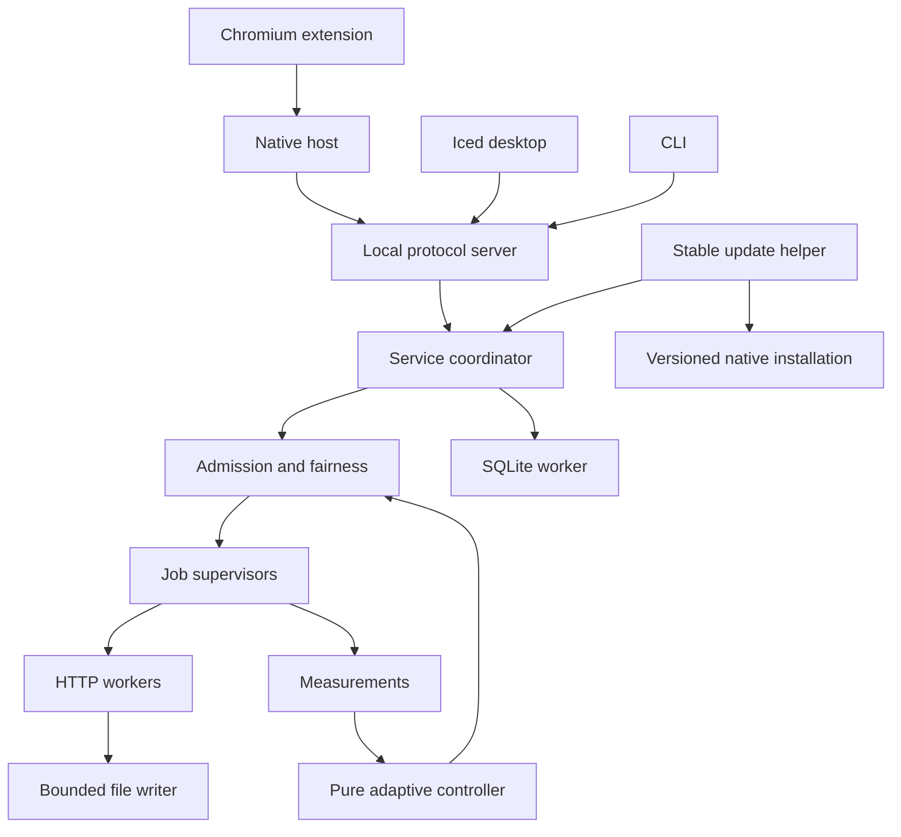
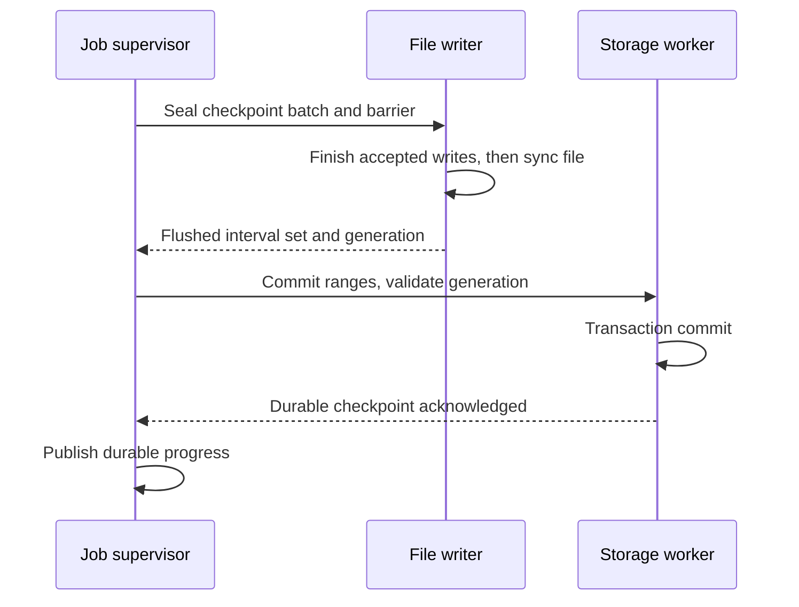
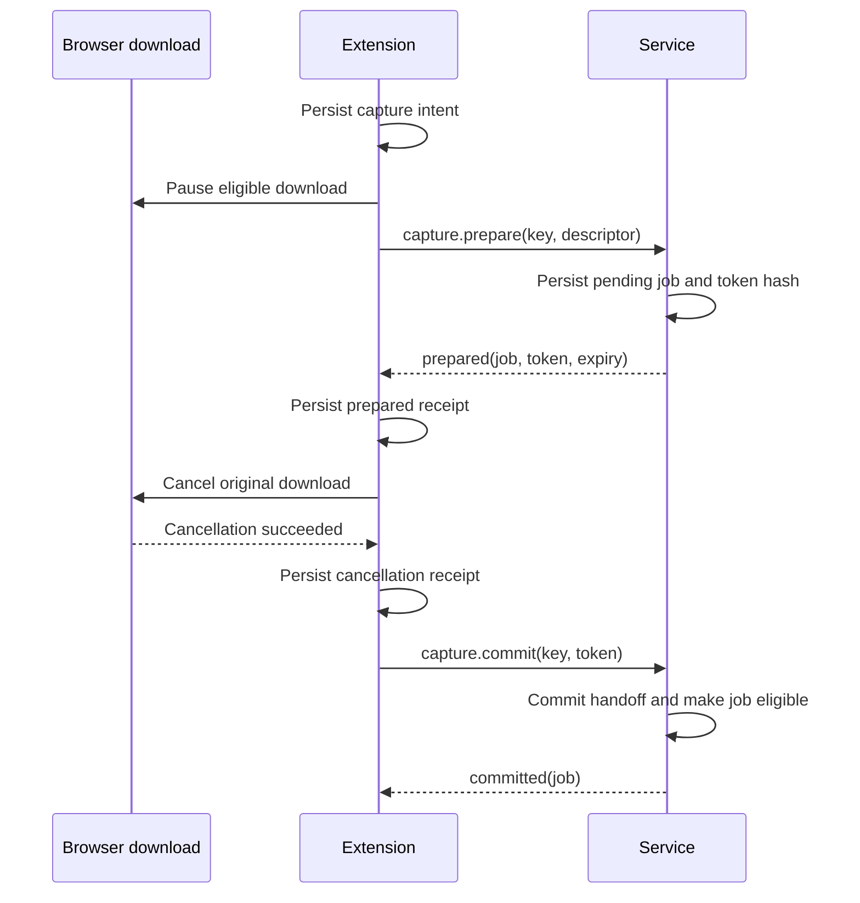

# Technical design: adaptive cross-platform download manager

Status: proposed implementation contract; no application code exists yet.
Date: 2026-11-17. Design revision: 1.

This document projects the [implementation plan](implementation-plan.md) into
component boundaries, data contracts, algorithms, persistence rules, and testable
failure behavior. Numerical defaults are initial engineering choices to benchmark,
not demonstrated performance results. Rust/SQL examples describe the intended
interfaces; they are not an implemented public API.

## 1. Scope, requirements, and invariants

The product comprises a Rust per-user download service, Rust CLI, Rust/Iced desktop
application, a Chromium Manifest V3 extension with TypeScript browser glue, and
native installation/update helpers. HTTP/HTTPS is the initial transfer scope.
The OS/browser targets and deferred features remain those in the implementation
plan. Clients share one queue per OS user; separate browser profiles have separate
capture identities, not separate native engines.

| ID | Requirement | Design sections | Primary acceptance evidence |
| --- | --- | --- | --- |
| R1 | Reliable resumable HTTP downloads | 5–7 | Protocol and crash-injection fixtures |
| R2 | Adaptive performance under changing conditions | 8–9 | Deterministic traces and shaped-network benchmarks |
| R3 | Parallel limit and sequential mode | 8 | Admission invariants, including settings changes |
| R4 | Chromium capture with safe fallback | 10–11 | Real-browser handoff crash matrix |
| R5 | Service, desktop, browser interfaces | 2–4, 12 | Shared protocol and reconnect tests |
| R6 | Selectable cross-platform installation | 13 | Clean-VM profile matrix |
| R7 | In-app automatic updates | 14 | Signature, replacement, migration, rollback tests |
| R8 | Minimal usable UI | 12 | Keyboard, accessibility, scaling and latency checks |
| R9 | 90% unit-test coverage | 16 | Unit-only Rust and TypeScript CI reports |
| R10 | Reviewable incremental implementation | 17 | Milestone deliverables and focused commits |

Correctness invariants take priority over throughput:

1. **Single owner:** only the service changes native jobs and their destination files.
2. **No mixed representations:** all retained bytes in a transfer generation belong
   to the same validated representation; changed or unknown identity prevents reuse.
3. **Disjoint writes:** two live workers never own overlapping byte intervals.
4. **Durable means flushed:** database-committed byte ranges refer only to file data
   flushed successfully before that transaction.
5. **Explicit completion:** a job completes only after verification, publication,
   and durable state reconciliation. Received byte count alone is insufficient.
6. **User limits win:** tuning cannot bypass file, range, origin, memory, or bandwidth
   limits. Decreasing a live limit has an explicit draining state.
7. **Pending is not runnable:** a browser-prepared job cannot download until its
   handoff is committed. Expiration never grants ownership to the service.
8. **No silent replacement:** destination conflicts never overwrite unrelated files.
9. **One update authority:** package-manager and self-updating installations never
   modify each other's owned files.
10. **Bounded resources:** bodies, IPC frames, queues, retry loops, and caches have
    explicit bounds; file size does not determine resident memory.

## 2. Components, dependencies, and process ownership



The service is one process with one instance lock per user/data directory. The
native host is a disposable bridge launched by Chromium; it never becomes the
download service or owns a transfer. Desktop exit and browser exit leave the
service running. Service startup is delegated to the platform launcher, with a
single-instance race check before database access.

The crate dependency graph must remain acyclic:

| Crate/application | Responsibility | Allowed internal dependencies |
| --- | --- | --- |
| `domain` | IDs, state transitions, validated settings, pure errors | None |
| `protocol` | Wire DTOs, validation, compatibility, error mapping | domain |
| `adaptive` | Samples to tuning decisions | domain |
| `scheduler` | Pure admission/fairness decisions and permit accounting | domain |
| `storage` | SQLite, migrations, durable command results | domain |
| `platform` | Paths, IPC transport, permissions, file publication, lifecycle, key store | domain |
| `engine` | Transport, range planning, transfer supervision and checkpoints | domain, platform |
| `updater` | Trust validation and update state machine | domain, platform |
| Service application library | Orchestrates the preceding crates | All preceding crates |
| CLI/desktop/native-host libraries | Commands, presentation, local connection | domain, protocol, platform |
| Update-helper library | Replacement and recovery orchestration | updater, platform |

Application libraries live beside thin executable entry points. Engine emits
checkpoint records through an interface; it does not query SQLite directly. The
coordinator commits them through storage. This makes network, filesystem, time,
and persistence failures independently injectable. Updater uses a separate bounded
HTTP client; it cannot depend on the service it must replace to finish installation.

### 2.1 Runtime tasks and backpressure

Use Tokio for network I/O and timers. One coordinator task serializes authoritative
job/settings commands; it awaits storage results before acknowledging mutations.
It never waits for a complete download. Each admitted job has a supervisor and
child request tasks in a tracked task set. Cancellation tokens carry user stop,
preemption, shutdown, and representation-change reasons.

SQLite runs on a dedicated worker thread. File operations run on a bounded blocking
pool or dedicated writer workers. No synchronous DB call, hashing pass, file sync,
or OS installer invocation runs on an async executor thread.

Initial resource limits:

| Resource | Initial bound | Full/slow behavior |
| --- | --- | --- |
| Coordinator commands | 256, with 32 reserved control slots | Reject admission with `busy`; allow pause/shutdown |
| DB requests | 128 | Backpressure coordinator; never drop accepted mutations |
| Global active HTTP requests | 24 | Queue work; include probes and redirect hops |
| Body blocks | 256 KiB each; two queued per active request | Stop polling body until writer makes space |
| Disk workers | Two initially | Serialize each file's write/barrier sequence |
| Event subscribers | 32 connections, 128 frames each | Coalesce progress; disconnect/resync lagging clients |
| Job list pages | 100 jobs, additionally byte-limited | Return cursor for next page |
| Durable jobs | 100,000 initial supported ceiling | Reject new admission with actionable cleanup message |

At 24 requests, queued body buffers account for approximately 12 MiB. TLS, HTTP/2,
socket, allocator, UI, and DB memory are additional and must be measured. Limit
transport read-ahead/windows and stream-frame handling during the transport spike;
application buffers alone are not a proof of the 150 MiB service target. File hashes
stream through bounded buffers. A panic in a worker fails its generation and releases
permits; a service crash enters recovery rather than silently marking jobs complete.

## 3. Domain model, settings, and state transitions

Use random UUIDs for jobs, handoffs, client installations, commands, and update
transactions. A `generation` monotonically increases whenever a job discards an
old representation and restarts. A `revision` increases on durable semantic changes
and enables compare-and-set commands. Progress samples do not bump the job revision.

Representative types, with constructors enforcing validation:

```rust
struct ByteRange { start: u64, end_exclusive: u64 }
struct Representation {
    final_url_secret: SecretRef,
    strong_etag: Option<String>,
    total_bytes: Option<u64>,
    identity_encoding: bool,
}
enum TransferMode { SingleStream, ValidatedRanges }
enum Intent { Run, Pause, Cancel }
enum Phase {
    Queued, Probing, Downloading, RetryWait, Paused,
    Verifying, Completed, Failed, Canceled, NeedsAuthentication,
}
struct Job {
    id: JobId,
    revision: u64,
    generation: u64,
    intent: Intent,
    phase: Phase,
    blocked_reason: Option<BlockedReason>,
    request_ref: SecretRef,
    destination: Destination,
    representation: Option<Representation>,
    mode: TransferMode,
    priority: Priority,
    queue_rank: i64,
}
```

`Phase` is a persisted user-visible lifecycle. `Intent` records the latest command
while a transition is draining. `blocked_reason` distinguishes user pause, resource
limit, metered network, origin cooldown, missing volume, and restart confirmation.
Handoff state is separate and gates job eligibility. Publication is a recoverable
substate of `Verifying`, not another user-visible completed state.

| From | Trigger / guard | Result |
| --- | --- | --- |
| Queued | Runnable intent, committed/no handoff, budgets available | Probing |
| Probing | Valid response and writable destination | Downloading |
| Probing/Downloading | Retryable request failure with attempts remaining | RetryWait |
| RetryWait | Deadline elapsed, runnable intent | Queued |
| Probing/Downloading/RetryWait | Pause request, workers stopped, checkpoint persisted | Paused |
| Downloading | EOF/complete range coverage and workers drained | Verifying |
| Verifying | Checksum/publication reconciliation succeeded | Completed |
| Any nonterminal phase | Authentication missing or expired | NeedsAuthentication |
| NeedsAuthentication | Credentials supplied, run requested | Queued |
| Paused/Failed | Explicit resume/retry, reuse safety checked | Queued |
| Any nonterminal phase | Cancel intent, workers joined, cleanup recorded | Canceled |
| Any nonterminal phase | Terminal validation, disk, or exhausted retry failure | Failed |
| Completed/Canceled | Download again | Create new job ID |

Pause during verification checkpoints the transfer and stops verification at a
safe point; resume reruns verification. Cancellation during publication is
serialized by the coordinator: once publication wins, return `already_completed`
and do not delete the final file. Cancel preserves partial data unless the request
explicitly asks to remove it; remove-history and delete-file are separate actions.

Persisted settings have a revision and validated schema. Initial defaults:

| Setting | Default | Validation / meaning |
| --- | --- | --- |
| `max_active_files` | 3 | 1–32; sequential maps to 1 and retains prior parallel value |
| `max_ranges_per_file` | 8 | 1–32; one means single-request concurrency |
| `max_requests_per_origin` | 8 | 1–64 |
| `max_requests_global` | 24 | 1–128; constrained by memory budget |
| `tuning_mode` | automatic after qualification | automatic, conservative, manual |
| `auto_active_files` | false | Optional slow controller; maximum remains user-controlled |
| `payload_rate_limit_bps` | null | Null means uncapped; otherwise positive integer |
| `capture_mode` | off until browser onboarding | off, context-menu, automatic |
| `updates` | automatic download, apply when idle | disabled, notify, automatic |
| `persist_auth` | false | Requires available OS key store |

Settings mutations validate the complete prospective configuration and commit
atomically. Live caps use the minimum of applicable limits; an origin cap larger
than the global cap is harmless. Effective limits and requested limits are both
visible during draining. Paths and credentials have separate validated DTOs.

## 4. Local protocol and client consistency

### 4.1 Transport, framing, and negotiation

Use Unix domain sockets in a user-owned runtime directory on Linux/macOS and
named pipes restricted to the current user on Windows. Reject an endpoint with
unexpected ownership/type; do not replace an arbitrary preexisting socket path.
Use peer credentials where available. Local same-user malware is outside the
isolation guarantee; do not portray socket permissions as a same-user sandbox.

Native IPC framing is a four-byte **little-endian** unsigned length followed by
UTF-8 JSON, maximum 256 KiB per frame. Reject zero/oversized/truncated frames before
allocation. Set a five-second idle handshake deadline and bounded command deadlines.
Browser native messaging has its own host-native-endian length framing; the bridge
decodes/re-encodes rather than assuming it is identical to internal IPC. Chrome
defines the framing and host registration requirements in its
[native messaging documentation](https://developer.chrome.com/docs/extensions/develop/concepts/native-messaging).

Handshake advertises supported protocol majors and optional capabilities. Revision
1 begins with major 1; add major 2 later while retaining major 1 through an explicit
deprecation window. Do not claim compatibility with a nonexistent major 0. Unknown
optional response fields are ignored; unknown commands, required capabilities, or
mutating request fields are rejected to avoid silently ignoring intent.

All byte counts, offsets, sequence counters, and revisions travel as decimal strings
so JavaScript never loses 64-bit precision. Counts with small validated ranges are
JSON numbers. Wire timestamps are UTC RFC 3339; active timeouts use monotonic time.
Unix paths can contain non-UTF-8 bytes: service-issued destination IDs are preferred;
an OS-tagged native path encoding is available to CLI/platform adapters. Browser
requests use a destination ID and sanitized filename, never raw arbitrary paths.

```json
{
  "protocol": 1,
  "request_id": "c852286e-7b2f-4a77-b026-55d8c0347d8f",
  "command": "job.pause",
  "idempotency_key": "6696f0ee-5c87-4de1-bbcf-90bd5d0e4b5e",
  "payload": {
    "job_id": "cdb8a5b6-2766-4e57-ac5b-c086af968afb",
    "expected_revision": "7"
  }
}
```

```json
{
  "protocol": 1,
  "request_id": "c852286e-7b2f-4a77-b026-55d8c0347d8f",
  "ok": true,
  "result": {
    "job_id": "cdb8a5b6-2766-4e57-ac5b-c086af968afb",
    "revision": "8",
    "intent": "pause",
    "phase": "downloading",
    "transition": "draining"
  }
}
```

The response acknowledges durable pause intent, not already-flushed worker exit.
A subsequent event reports `paused`; CLI `--wait` waits for that state with a
timeout. Errors include `code`, safe `message`, `retryable`, optional `retry_after_ms`,
and optional `current_revision`. Never embed raw URLs/headers in error strings.

### 4.2 Command surface

| Command | Important inputs | Contract |
| --- | --- | --- |
| `hello` | versions, client kind, capabilities | Negotiated major, service epoch, available capabilities |
| `job.add` | request descriptor, destination ID, options | Durable job ID; idempotent admission |
| `job.list` / `job.get` | filter, cursor / ID | Redacted snapshot; no credentials |
| `job.pause/resume/cancel/retry` | ID, expected revision | Persist intent, return current transition |
| `queue.reorder` | affected IDs, expected queue revision | Atomic order change |
| `settings.get/patch` | patch and expected settings revision | Validate, persist, then reconcile runtime |
| `events.subscribe` | service epoch, last sequence | Events or `resync_required` |
| `capture.prepare/commit/abort/status` | capture identity, token, descriptor | Browser ownership protocol in section 10 |
| `auth.attach` | job ID, opaque credential payload, retention | Scoped secret replacement, no secret echo |
| `update.check/status/apply` | policy override where permitted | Update state machine, no arbitrary artifact URLs |
| `service.shutdown` | checkpoint timeout | Restricted local management action |

The native host exposes a browser-specific subset; no shutdown, raw path access,
arbitrary update sources, shell execution, or unrestricted filesystem operations.
Validate native caller extension origin against installed IDs. Do not declare an
`externally_connectable` website bridge. Treat all received descriptors as untrusted.

For ordinary mutating commands, storage commits the mutation and idempotency result in one
transaction. Repeating a key and identical canonical payload returns the original
result; the same key with different input returns `idempotency_conflict`. Use a
keyed payload digest when secrets are involved; no plaintext secret in the result.
Ordinary command receipts expire after seven days, an explicit retry window.
Capture receipts live as long as their job/tombstone reconciliation window. Capture
preparation uses the identity/renewable-token contract in section 10 instead of
persisting a secret token in a generic command receipt.

### 4.3 Snapshots and events

Each service start creates a random epoch and event sequences start at one. A
bounded 10,000-entry in-memory event ring supports short reconnects; progress is
coalesced to at most four updates per job per second. Durable state changes are
published only after commit. Progress is volatile and labeled separately from
durable bytes.

Snapshot creation records an event watermark and a consistent read snapshot.
Pagination uses that snapshot for at most thirty seconds; expiration forces a
restart. Clients subscribe after the watermark and apply events in order. Different
epoch, sequence gap, or overwritten events trigger a fresh snapshot. Events are
not an audit log and are never the only record of an accepted command.

## 5. Persistence, credentials, and restart recovery

### 5.1 Schema and storage ownership

Use one local SQLite database with foreign keys enabled, WAL mode, full synchronous
durability, a bounded busy timeout, and controlled WAL checkpoints. Keep the DB on
a local filesystem, even when a user downloads to a removable/network destination.
WAL behavior and durability tradeoffs are described by
[SQLite WAL documentation](https://sqlite.org/wal.html). Our selected configuration
is a product choice; validate the bundled SQLite release during dependency pinning.

The following is executable starter DDL illustrating core relations. IDs are
validated UUID text at the application boundary; states use validated codecs.
Representations/settings/secrets have versioned payloads. Additional indexes and
constraints belong in reviewed migrations, not ad hoc startup SQL.

```sql
PRAGMA foreign_keys = ON;

CREATE TABLE schema_migrations (
    version INTEGER PRIMARY KEY,
    checksum TEXT NOT NULL,
    applied_at TEXT NOT NULL
);
CREATE TABLE secrets (
    id TEXT PRIMARY KEY,
    retention TEXT NOT NULL CHECK (retention IN ('session', 'persistent')),
    ciphertext BLOB,
    key_version INTEGER,
    CHECK ((retention = 'session' AND ciphertext IS NULL AND key_version IS NULL) OR
           (retention = 'persistent' AND ciphertext IS NOT NULL AND key_version IS NOT NULL AND key_version >= 1))
);
CREATE TABLE jobs (
    id TEXT PRIMARY KEY,
    revision INTEGER NOT NULL CHECK (revision >= 1),
    generation INTEGER NOT NULL CHECK (generation >= 1),
    intent TEXT NOT NULL CHECK (intent IN ('run', 'pause', 'cancel')),
    phase TEXT NOT NULL,
    blocked_reason TEXT,
    source_kind TEXT NOT NULL,
    request_secret_id TEXT NOT NULL REFERENCES secrets(id),
    representation_secret_id TEXT REFERENCES secrets(id),
    destination_id TEXT NOT NULL,
    native_path BLOB NOT NULL,
    display_name TEXT NOT NULL,
    mode TEXT NOT NULL CHECK (mode IN ('single_stream', 'validated_ranges')),
    total_bytes INTEGER CHECK (total_bytes >= 0),
    priority INTEGER NOT NULL CHECK (priority BETWEEN 0 AND 2),
    queue_rank INTEGER NOT NULL,
    retry_count INTEGER NOT NULL DEFAULT 0 CHECK (retry_count >= 0),
    retry_at TEXT,
    last_error_code TEXT,
    created_at TEXT NOT NULL,
    updated_at TEXT NOT NULL
);
CREATE INDEX jobs_admission ON jobs (phase, priority, queue_rank);
CREATE TABLE durable_ranges (
    job_id TEXT NOT NULL REFERENCES jobs(id) ON DELETE CASCADE,
    generation INTEGER NOT NULL,
    start INTEGER NOT NULL CHECK (start >= 0),
    end_exclusive INTEGER NOT NULL CHECK (end_exclusive > start),
    checkpoint_id TEXT NOT NULL,
    PRIMARY KEY (job_id, generation, start)
);
CREATE TABLE capture_handoffs (
    capture_key TEXT PRIMARY KEY,
    job_id TEXT NOT NULL UNIQUE REFERENCES jobs(id),
    state TEXT NOT NULL CHECK (state IN ('prepared', 'committed', 'aborted', 'expired')),
    token_hash BLOB NOT NULL,
    prepared_at TEXT NOT NULL,
    expires_at TEXT NOT NULL,
    updated_at TEXT NOT NULL
);
CREATE TABLE command_receipts (
    client_id TEXT NOT NULL,
    idempotency_key TEXT NOT NULL,
    request_digest BLOB NOT NULL,
    result_json TEXT NOT NULL,
    expires_at TEXT NOT NULL,
    PRIMARY KEY (client_id, idempotency_key)
);
CREATE TABLE publications (
    job_id TEXT PRIMARY KEY REFERENCES jobs(id),
    generation INTEGER NOT NULL,
    stage TEXT NOT NULL CHECK (stage IN ('prepared', 'published', 'confirmed')),
    source_identity BLOB NOT NULL,
    destination_path BLOB NOT NULL,
    size_bytes INTEGER NOT NULL CHECK (size_bytes >= 0),
    expected_digest TEXT
);
CREATE TABLE settings (
    singleton INTEGER PRIMARY KEY CHECK (singleton = 1),
    revision INTEGER NOT NULL CHECK (revision >= 1),
    schema_version INTEGER NOT NULL,
    value_json TEXT NOT NULL
);
```

The DDL does not enforce disjoint ranges by itself. A storage transaction checks
generation, interval ordering, and total size before insertion/compaction. Merge
adjacent durable ranges to bound metadata growth; keep planned/live leases in
memory. After a crash, all leases disappear and only durable ranges remain trusted.
Reject files/offsets above SQLite's signed 64-bit range in revision 1. Use checked
arithmetic for interval ends, HTTP inclusive endpoints, and allocation sizes.

### 5.2 Secret storage

Separate safe display metadata from request descriptors, which may include signed
query strings, headers, cookies, and redirect URLs. Session-only secrets reside in
memory and have a null-payload DB marker. After restart, affected jobs require
authentication/re-entry. A user may explicitly classify a URL as public for durable
plain storage in a future revision; revision 1 encrypts persistent descriptors.

For persistent retention, generate an installation data key and store it through
the OS credential provider; encrypt DB secret payloads with a vetted AEAD library,
fresh nonces, and associated data binding record ID and schema version. Do not
design a new cipher or put the key beside the database. Key-unavailable/locked
states block only affected jobs. No plaintext fallback; rotation records key
versions and re-encrypts transactionally. Secrets never enter ordinary event payloads.

Incognito jobs use a separate in-memory store and do not survive service restart;
the UI states that limitation. Files the user explicitly saves still exist. Protect
state/log directories with user-only permissions, and disclose that filenames and
destination paths remain local metadata rather than claiming full database secrecy.

### 5.3 Checkpoint and recovery protocol



Initially checkpoint when dirty accepted data exceeds 8 MiB or has been dirty for
two seconds, plus pause, cancellation, shutdown, and finalization. A file writer
serializes barriers with writes; no writes cross a claimed barrier. Persist partial
prefixes of leases only when flushed; split the remaining lease safely in memory.
DB failure after flush leaves harmless unclaimed bytes, which can be overwritten.
Flush failure never advances durable intervals. No fsync per body block.

On startup, hold the instance lock, validate/migrate DB, reconcile publication and
update journals, then examine nonterminal jobs. Treat persisted `downloading` and
`probing` as interrupted; preserve user pause/cancel intent. Check the partial file's
identity, size, and generation before reopening. Ignore uncommitted bytes and reject
committed intervals beyond the file's size. A missing/replaced file requires explicit
restart; do not silently reuse it. Revalidate remote representation before scheduling
missing ranges. A nonresumable stream requires restart confirmation if progress
would be discarded. Removable-volume absence is a recoverable blocked state.

## 6. HTTP transport and representation safety

The engine has an injected transport interface returning response metadata and a
bounded async body stream. Production uses reusable reqwest clients partitioned
by proxy/TLS configuration and credential isolation context. No global cookie jar.
No invalid-certificate bypass. Honor configured proxy credentials without logging
them; PAC/system-proxy parity is a phase-0 investigation, not a v1 guarantee.

Configure redirects explicitly, disable automatic content decoding, and request
identity encoding. reqwest exposes these policies through
[ClientBuilder](https://docs.rs/reqwest/latest/reqwest/struct.ClientBuilder.html).
Redirects are processed one hop at a time so origin budgets and header policies
can be reevaluated; cap the chain at ten. Strip origin-bound credentials on origin
change, refuse HTTPS-to-HTTP downgrade without an explicit job policy, and never
copy captured cookies indiscriminately to a new destination.

Selected protocol rules are grounded in
[RFC 9110](https://www.rfc-editor.org/rfc/rfc9110.html): byte ranges use inclusive
HTTP endpoints, 206 carries partial content, 200 may indicate range fallback, 416
requires range re-evaluation, and validators constrain representation reuse.
The stricter reuse policy below is our implementation choice.

### 6.1 Initial request and segmentation policy

1. Start one GET with identity encoding; HEAD is optional and cannot establish
   that ranges work. User-entered URLs have an explicit replay policy; captured
   URLs require browser eligibility evidence from section 10.
2. Inspect headers before consuming data. Stream the original response as the
   baseline. An unknown length or missing strong ETag keeps this generation in
   single-stream mode. Small files below 8 MiB remain single-stream initially.
3. When replay is allowed, size is known, and the response supplies a strong ETag,
   the controller may request transition to range mode. Stop the initial request
   at a flushed prefix, release it, and probe the next missing finite range with
   `If-Range` and that validator. Do not run overlapping writers during transition.
4. Enable additional leases only after a matching 206 confirms the expected range,
   total length, encoding, and representation. A 200 response never writes into
   the requested offset: stop all range work and restart a clean single-stream
   generation under replay policy. No automatic endless fallback cycle.
5. On changed identity, retire all workers, increase generation, clear old durable
   ranges, and restart only when policy permits. A user may require confirmation
   instead. A weak ETag or Last-Modified alone does not authorize segmented reuse
   in revision 1. This intentionally sacrifices some acceleration for certainty.

Single-stream bodies with unknown length become complete only after successful
protocol EOF. Unexpected nonidentity Content-Encoding produces a clear unsupported
encoding error in revision 1; do not save compressed wire bytes under a misleading
filename. Browser-origin jobs expose a manual browser recovery action. A future
decoded single-stream mode must define its own resume/checksum semantics first.

### 6.2 Validation and failure policy

| Condition | Action |
| --- | --- |
| Valid full response | Stream with bounded buffers; enforce announced length if present |
| Valid range response | Validate exact requested coverage before committing bytes |
| Short/overlong body | Fail attempt; retain only safely checkpointed valid prefix |
| Invalid/overlapping range metadata | Stop generation; do not assemble ambiguous bytes |
| 416 | Revalidate size/identity; complete only if local verified coverage is exact |
| 401/403 | Stop automatic retries; require refreshed auth or user retry |
| 404/410 | Terminal failure unless user explicitly retries |
| 429/503 | Origin cooldown; honor valid Retry-After, notify controller |
| Network reset/timeout/other selected 5xx | Bounded retry with jitter if replay is permitted |
| TLS failure, unsafe redirect, invalid URL scheme | Terminal policy error |
| Disk full/permission/missing volume | Stop reads, checkpoint what is safe, expose recovery action |

Initial deadlines: connection 15 seconds, headers 30 seconds, body idle 30 seconds;
no short total timeout for an entire large file. Suspend idle timers while reads
are intentionally blocked by our rate limiter/writer, and reset after system sleep.
Retry an interval at most five times within a generation, with full jitter over
`[0, min(60 seconds, 1 second × 2^attempt)]`. A server Retry-After deadline is a
minimum, never shortened by the jitter cap. Long server waits remain visible and
cancelable. Bound total job retries separately to prevent many intervals multiplying
an outage into unbounded requests.

## 7. Range execution, disk pipeline, and publication

### 7.1 Planner and leases

Internally represent intervals as half-open `[start, end)`. For known total `L`,
the desired domain is `[0, L)`; subtract durable ranges and live leases to obtain
unassigned work. Allocate from the earliest hole first, then split large holes
using the current target chunk size. Each lease carries job ID, generation, lease
ID, bounds, and cancellation token. The writer validates these before accepting
blocks. Stale-generation blocks are discarded, not written.

Maintain ordered interval sets in memory; periodically compact durable adjacency.
The supervisor is the sole allocator. Completion requires the union of committed
ranges to equal `[0, L)` and no live workers. Do not pre-create a row for every byte
or every possible chunk. Resume allocates holes, not previously completed ranges.

Each block includes its absolute offset. The writer handles partial OS writes and
bounded retries; a syscall reporting success for fewer bytes does not complete a
block. Cancel joins workers before allowing their leases to be reassigned. Optional
preallocation failure can fall back to ordinary writes, except genuine disk-full
conditions. Sparse allocation alone is not a guarantee that future writes will fit.

### 7.2 Safe file publication

Use a private per-job staging directory on the destination filesystem and hold
validated directory/file handles. Do not rely solely on a string-prefix path check;
reject symlink/reparse escapes and unsupported destination semantics. Treat server
filenames as hints, remove path components, validate reserved names and length,
and reserve collisions through exclusive filesystem operations.

Publication protocol:

1. Drain workers and checkpoint every remaining byte. Verify length and optional
   externally supplied digest with a streaming pass. Digest mismatch is terminal
   for that attempt; retain diagnostic metadata without publishing the file.
2. Apply required OS provenance metadata before publication. Record a `prepared`
   publication intent including source file identity and intended destination.
3. Publish with a platform no-replace operation in the same filesystem; flush file
   metadata and destination directory where supported. If the target exists, choose
   a new collision suffix through another no-replace attempt.
4. Record `published`, then commit `completed` plus `confirmed`. Delete obsolete
   staging metadata only after confirmation.

The platform abstraction must prove the semantics of no-replace publication and
stable file identity on supported local filesystems. If unavailable, offer a
conservative explicit finalization path; do not substitute an overwriting rename.
Cross-filesystem moves are not atomic and are outside this fast path.

Crash recovery checks both staging and final paths against the recorded identity
and generation. A verified matching final file can finish the transaction. An
unrelated destination conflict is never declared completed or deleted. If both
names exist after a platform link-based publication, reconcile only matching file
identity before removing the staging link. Missing/ambiguous evidence yields a
recoverable error. File identity, not name alone, distinguishes our published file.

## 8. Scheduler, fairness, limits, and bandwidth

Admission is centralized to avoid independent worker semaphores deadlocking while
waiting on different budgets. The scheduler atomically reserves applicable tokens
and hands a lease to the engine. RAII cleanup plus supervisor reconciliation returns
tokens on success, failure, cancellation, or panic. Invariant tests inspect counters.

An active file is a probing or downloading job, including one draining its workers;
verification has a separate bounded disk/hash budget. Retry-wait/paused jobs consume
no HTTP or active-file permits. A range request consumes one global and one origin
permit; the origin is normalized scheme/host/port after each redirect. H2 streams
count as requests even if they share a TCP connection. Redirecting releases the old
request's global/origin permits before atomically acquiring the new pair; it retains
the job's file permit. It never holds one request permit while waiting for the other.

Admission order:

```text
reconcile completed/draining jobs and release permits
filter by run intent, committed handoff, available secrets and destination
exclude jobs whose retry/origin deadlines have not elapsed
compute effective priority from base priority plus bounded wait-time aging
group eligible jobs by current origin; round-robin origins within priority class
choose oldest queue rank within the selected group
reserve file/global/origin permits as one operation
start a probe or next range only if all constraints fit
```

Use three base priority levels. Every sixty seconds of eligible wait promotes a
job one level up to the highest level; maintain admission wait age across failed
starts and reset after useful service. A continuing file receives range leases in
round-robin turns with peers. FIFO applies within priority/origin fairness rules,
not strict global FIFO that permits a throttled host to block every other origin.
Aging guarantees ordering opportunities as slots free up; it does not guarantee
bounded wait when all active slots hold indefinitely running nonpreemptible streams.
Users can pause or cancel such streams; automatic time-slicing of them is out of scope.

Reducing max files to one keeps the highest-priority oldest active job and drains
others. No replacement starts until active counts comply. The command response
reports transition state; the invariant after convergence is one active file, not
one TCP connection. Nonresumable excess jobs stop and become paused with
`restart_required`, making the cost visible. Range-limit decreases retire leases
at checkpoints; growth never exceeds new limits while old leases drain.

One shared payload token bucket applies before accepting additional body data,
with weighted fair allocation among active jobs. Burst capacity starts at 250 ms
of the configured rate with a 256 KiB maximum; reads may be smaller than a body
block. The setting limits application payload over time, not TLS/IP overhead or
already-buffered network data. Coordinate update downloads with this limiter when
the service is running; use a conservative standalone cap during maintenance.

## 9. Adaptive controller specification

The controller is a pure function over observations and prior state. It returns
proposals; the scheduler clamps them to current user/resource limits. No network,
filesystem, wall-clock access, or hidden random source is allowed in this crate.

```rust
fn step(
    state: &ControllerState,
    sample: &Observation,
    limits: &EffectiveLimits,
) -> (ControllerState, Vec<Proposal>);

enum Proposal {
    SetRangeTarget { job: JobId, ranges: u16 },
    SetChunkBytes { job: JobId, bytes: u64 },
    SetFileTarget { files: u16 },
    CooldownOrigin { origin: OriginId, duration_ms: u64 },
}
```

### 9.1 Measurement definition

One-second observations include newly accepted unique file bytes, wire-body bytes,
durable bytes, active/busy time, TTFB, request errors, throttle signals, writer queue
delay, memory utilization, and assigned ranges. Goodput is new valid bytes accepted
by the writer per elapsed active second; duplicate/redownloaded offsets within a
generation do not count twice. Durable bytes are reported separately because sync
batching would otherwise distort control samples. Mark samples invalid when a
representation is discarded, topology changes, or measurement duration is too short.

Use EWMA `g_t = 0.3 × sample_t + 0.7 × g_(t-1)` for display and trend detection;
evaluate trials with medians of five valid one-second samples. TTFB is a response
delay signal, not RTT. Infer neither packet loss nor physical link speed from it.
Origin/network hints expire after ten idle minutes and reset on interface/proxy/VPN
changes; raw hostnames are not exported as metrics.

### 9.2 Control states and decisions

| State | Enter / action | Exit |
| --- | --- | --- |
| Warmup | One range; gather five valid samples | Stable baseline or pressure |
| Stable | Retain targets; observe remaining work and constraints | Eligible trial or pressure |
| Trial | Add one range, hold other knobs fixed, gather five samples | Accept or revert |
| Cooldown | Suppress increases for fifteen seconds | Stable if pressure cleared |
| Recovering | Halve target on throttling/repeated stalls, minimum one | Server deadline plus clean samples |

Only one upward experiment per network epoch runs at a time to reduce interference
between jobs/origins. A trial is allowed only for validated range mode, at least
8 MiB of remaining work, enough predicted runtime for an observation window, free
budgets, no payload-cap saturation, and no disk/memory pressure. A newly saturated
origin/global budget cancels the experiment as inconclusive rather than recording
false evidence that extra streams do not help.

Let `B` be the five-sample baseline median goodput and `T` the trial median. Keep
the increment only if `T >= 1.05 × B`, there are no new throttle signals, and writer
delay/response-time guards pass. Initial guards: p95 writer queue delay below
100 ms, memory below 80% of its budget, and no greater than 50% increase in median
TTFB when enough comparable samples exist. If insufficient data, revert the trial.
These thresholds require benchmark calibration. A completed file ends its trial.

On a 429/503 throttle signal, halve the affected origin's target and enforce its
server cooldown. Repeated timeouts/stalls trigger a decrease after two windows;
disk pressure reduces aggregate range work immediately. Do not attribute every
throughput reduction to congestion: record the chosen reason and suppress trials
when the user cap or disk is binding. Manual mode disables exploration but still
honors server backoff and resource safety.

Set future chunk size to `clamp(per_range_goodput × 3 seconds, 1 MiB, 32 MiB)`,
rounded to a 64 KiB boundary and clipped to the remaining hole. Chunk size is
assignment granularity, not an in-memory allocation. Change it only outside a
concurrency trial; never discard good in-flight work to resize it.

Optional file-count tuning is disabled initially. When enabled after benchmarking,
it operates no more often than every thirty seconds, freezes range experiments
during its evaluation, and changes its target by one below the user maximum.
Sequential mode fixes that target at one in every state. Conservative mode caps
automatic ranges at two; manual mode uses explicit targets. Offline transitions
suspend attempts, and wake-up starts a new warmup epoch.

### 9.3 Stability and replay tests

Recorded traces contain measurements, limits, decisions, and reason codes, excluding
URLs and credentials. Feed them through the same pure function used in production.
Assert bounded targets, no growth during cooldown, eventual return to one under
persistent throttling, no oscillation on constant-capacity traces, and correct
reset on topology changes. Benchmark the whole engine because a controller trace
alone cannot establish network throughput or fairness.

## 10. Chromium capture and ownership transfer

### 10.1 Eligibility and permissions

Use `downloads`, `storage`, `nativeMessaging`, and `contextMenus` for the relevant
features. Request host access, cookies, and request observation only when enabling
the corresponding capture/authentication behavior; permission denial leaves manual
or browser-owned operation usable. Incognito capture requires explicit opt-in.

Automatic capture observes a download after it begins, so some browser traffic can
already have occurred. The [downloads API](https://developer.chrome.com/docs/extensions/reference/api/downloads)
provides lifecycle and pause/cancel operations; it does not provide a universal
replayable request. Method/context correlation must be proven by the phase-0 spike.
Unknown correlation, POST/body-dependent responses, blobs/data URLs, known single-use
links, client-certificate flows, and blocked/dangerous downloads remain browser-owned.

An optional request-observation cache is bounded to 128 entries and 4 MiB total,
with a thirty-second TTL. Individual request descriptors are capped at 64 KiB;
oversized credentials/headers fall back to browser ownership. The cache stores only
permitted candidate metadata and is cleared on suspension/restart.
It must match profile, tab/frame context, method, URL, timing, and redirect evidence;
ambiguous matches are rejected. Ordinary MV3 operation must not require blocking
webRequest access. [Chrome webRequest](https://developer.chrome.com/docs/extensions/reference/api/webRequest)
documents that restriction. This cache is an optimization, not a source of inferred
credentials for unrelated downloads.

Captured cookie handling must honor the correct profile/store and partition context.
Never assemble cookies by domain alone or copy an entire jar. Explicitly model the
cookie access rules required for that request; if they cannot be faithfully applied,
fall back. See [Chrome cookies](https://developer.chrome.com/docs/extensions/reference/api/cookies).
Captured descriptors are short-lived and memory-only unless the user opts into
retention. Expired authentication becomes `needs_authentication`, not infinite retries.

### 10.2 Idempotent prepare/cancel/commit

A capture key hashes the extension installation UUID, browser session UUID, download
ID, and recorded start time. Session identity lives in session storage across MV3
worker restarts; the handoff journal lives in persistent extension storage without
credentials. Losing identity fails conservatively; it does not generate a second
native job from an uncertain old handoff.



`prepare` returns the same job for repeated keys and rejects changed original
descriptors under that key. Use a random 256-bit commit token and store only its
hash in the service. If a prepare response is lost, the same originating client can
repeat preparation while state remains `prepared`: atomically issue a new token,
invalidate the old token, and return the existing job. Serialize prepare attempts
in the extension; stale-token errors trigger status reconciliation. A preparation
retry after commit returns committed status without a new token. This guarantees
idempotent job identity, not an identical secret-bearing response. Token renewal
never revives an expired/aborted record or extends its maximum lifetime indefinitely.
Prepared jobs consume no transfer permits.
Initial preparation TTL is two minutes with a bounded renewal while the browser
is known paused. Commit atomically checks token, expiry, and state. Repeat commit
returns the original job; abort cannot revoke a committed transfer. Extensions use
normal job cancellation after commitment.

After preparation, cancellation must succeed before commit. Check that the browser
has not completed; if it completed, abort and keep the browser file. If pause or
cancel fails, abort prepared state and resume the browser where supported. If the
service already committed, never automatically restart the browser as fallback.

### 10.3 Crash reconciliation

| Durable observations after reconnect | Action |
| --- | --- |
| Service committed, extension unsure | Attach to existing native job; do not recapture |
| Service prepared, browser active/paused | Recheck eligibility; continue cancel/commit or abort/resume |
| Service prepared, durable cancellation receipt exists | Retry commit if lease valid |
| Service prepared, browser canceled but no cancellation receipt | Ownership ambiguous; require recovery choice, do not auto-start |
| Service prepared, browser completed | Abort native job; keep browser result |
| Service expired/aborted after browser cancellation | Show retry/recover action; never revive expired job silently |
| Browser item/history missing | Query service first; ambiguity stays blocked |
| Native host unavailable before preparation | Leave browser ownership unchanged |

The unavoidable gap between browser cancellation and receipt persistence is exposed
as a recovery state. We guarantee idempotent native admission under a retained key,
not a distributed exactly-once transaction across unrelated processes. Tombstones
are retained for at least thirty days and while referenced by live jobs; an old
unknown capture cannot automatically bypass retention expiry. Store fallback markers
before initiating explicit browser recovery to avoid recapture loops.

## 11. Extension-only behavior and browser bridge

With no native host, the extension offers a browser-owned queue for replayable,
extension-initiated URLs and best-effort pause/resume for observed downloads. Show
“Browser mode” and explain that native acceleration/background persistence requires
the service. Do not promise strict sequential admission for arbitrary browser
downloads: events arrive after initiation and pause may fail.

Persist the browser queue and reconcile IDs/status after MV3 worker restart. If a
browser download cannot be paused, leave it running and show the limitation. Keep
host connection state separate from capture toggle so installing/uninstalling the
service does not unexpectedly seize browser downloads.

The Rust host reads/writes framed JSON on standard streams, logs only to stderr or
the redacted log sink, validates the allowed extension origin, and connects to the
user service. It may request platform service startup and wait up to five seconds.
No payload data, cookies in logs, shell snippets, or unbounded buffering are allowed.
Version incompatibility returns an actionable update message; it never cancels a
browser download before compatibility is established.

## 12. Desktop, CLI, and presentation state

The Iced application uses a pure `Model + Message -> Model + Effects` layer. Effects
send typed protocol commands; view code does not open SQLite or instantiate engines.
The model keeps paged job summaries, selection, filters, settings revision, connection
state, and in-flight command IDs. Acknowledge clicks immediately with a pending
indicator; reconcile to server state on error or reconnect. Never optimistically
display completed/paused before authoritative confirmation.

Main window: toolbar with Add URL and search; All/Active/Completed filters; virtualized
rows with name, progress, speed, ETA, status and contextual controls; footer with
aggregate speed and parallel/sequential mode. Unknown lengths use indeterminate
progress and no fabricated ETA. ETA uses remaining valid bytes and smoothed goodput,
is hidden during stalls, and is labeled an estimate.

Settings expose the planned primary controls; origin/range internals stay in an
advanced panel. Details show destination, error recovery, resumability, effective
tuning state, and redacted source. Browser popup uses the same status terminology.
Platform notifications and tray actions call the same command layer; tray support
is optional when a desktop environment lacks it. Closing the UI keeps the service;
“Quit and stop downloads” is a distinct explicit action.

CLI commands mirror the service: `add`, `list`, `pause`, `resume`, `cancel`, `retry`,
`settings`, `watch`, and `update`. Offer machine-readable JSON and documented exit
codes: success, invalid input, unavailable/incompatible service, rejected command,
and terminal job failure when waiting. Read secrets through protected stdin/file
inputs instead of encouraging credentials in shell history. OS-native paths remain
lossless through platform adapters.

Phase 0 validates Iced accessibility semantics, IME, focus navigation, screen-reader
labels, DPI/scaling, light/dark mode, and renderer fallback on target platforms.
If a required capability is blocked, record an ADR before replacing the toolkit;
do not postpone accessibility until after UI implementation.

## 13. Platform lifecycle and component installation

| Platform | Per-user lifecycle | Data/config/runtime | Native installation shape |
| --- | --- | --- | --- |
| Linux | systemd user service where available; explicit foreground fallback | XDG data/config/state/runtime locations | User-owned version directories and stable launchers |
| macOS | LaunchAgent | Application Support, Caches, user-owned runtime location | Versioned signed app bundles plus stable launch entry |
| Windows | Logon startup registration launching user daemon | LocalAppData and user-scoped named pipe | Version directories plus stable launcher/helper |

The service does not require administrator privileges for normal downloading.
Lifetime beyond logout is not assumed. A future privileged system-service profile
must have a separate security design. Launchers enforce one instance and validate
install ownership. Resolve user folders through OS APIs; do not hard-code English
“Downloads” directory names.

Installer component dependency graph:

```text
desktop     -> service -> CLI, updater
native-host -> service
extension   -> store installation (native host optional, with reduced mode)
```

A versioned install manifest records installation ID, channel/owner (`self` or
`package_manager`), architecture, components, current/previous version, startup
registration, supported browser host manifests, and protocol/schema compatibility.
The installer computes dependency closure and displays changes before applying
selected components. Repair validates files and registrations against this manifest.
Uninstall removes only owned registrations/files; downloaded files survive unless
separately and explicitly selected for deletion.

Install/modify operations have their own durable transaction journal under the
installation root: prepare, stage, verify, register, activate, finalize. On failure,
restore prior registrations and active version. Obtain the same installation lock
used by the updater so repair, uninstall, and updates cannot overlap. Downloads are
checkpointed before removing the service component.

The browser extension uses supported store installation/update flows; a native
installer registers the host and guides the user rather than promising silent
activation. [Chrome installation methods](https://developer.chrome.com/docs/extensions/how-to/distribute/install-extensions)
describe platform restrictions. Detect native Chrome/Edge/Brave registrations
separately. Snap/Flatpak Chromium remains a feasibility gate: report unsupported
host discovery clearly rather than claiming compatibility with every package.

Linux self-updating user installations and optional signed APT packages are distinct
channels. For APT ownership, in-app check displays package-manager status and must
not replace dpkg-owned files. Native macOS bundles are signed/notarized as complete
release artifacts; updates must preserve bundle integrity. Windows releases need
signed executables/installers and provenance-aware download finalization. Exact
OS signing and registration APIs require platform spike verification.

## 14. Update trust, replacement, and rollback

### 14.1 Release metadata and authority

Use a maintained TUF client, initially evaluate `tough`, with an embedded root,
persisted trusted metadata, expiration/rollback checks, bounded downloads, and key
rotation. Roles and verification order follow the
[TUF specification](https://theupdateframework.github.io/specification/latest/);
do not implement an approximate signature protocol from this document.

Each signed release target binds OS/architecture, product/version/channel, selected
component set, hashes/lengths, protocol range, readable/writable DB schema range,
minimum updater version, and release epoch. TLS protects transport in addition to
artifact verification. Staged rollout uses a local random installation cohort and
signed rollout policy; no download history is uploaded. Bad clock/expired metadata
blocks updating with an actionable error instead of disabling freshness checks.

Use offline threshold root ownership and separate release-signing roles as a
release-operations deliverable. Private signing keys never ship in the repository
or application. Build provenance, dependency inventory, and signed artifacts are
release outputs; code signing complements rather than replaces TUF verification.

### 14.2 Transactional application

```text
Idle -> Checking -> Available -> Downloading -> Verified -> WaitingForIdle
     -> Quiescing -> Switching -> HealthCheck -> Committed
                                    |              |
                                    +--> Rollback <-+
```

Failures before switching keep the current installation runnable. The stable
helper owns an update journal outside version directories, including transaction
ID, old/new version, installed components, trusted target identity, DB snapshot,
activation stage, and health result. Changes to that journal are flushed before
the corresponding destructive/replacement step.

1. The service downloads and verifies a complete component-compatible release into
   a new staging directory. Archive extraction rejects traversal, unsafe links,
   excessive expanded size, duplicate paths, and wrong platform artifacts.
2. Acquire the installation lock, freeze new admissions, drain/checkpoint downloads,
   stop UI/host processes as needed, and close the service DB cleanly. Refuse an
   automatic update that would discard nonresumable progress; wait for completion
   or an explicit maintenance restart choice.
3. Make a consistent SQLite snapshot with the backup API while quiesced, or after
   clean closure using a validated procedure. Never copy only a live WAL database
   file. [SQLite backup API](https://sqlite.org/backup.html) supplies the snapshot
   mechanism; the update transaction supplies the policy.
4. The helper installs an immutable version directory and switches the stable
   launcher's selected version through a flushed, recoverable activation record.
   On Unix a validated pointer can be atomically replaced; on Windows processes
   exit before replacing any in-use executable. Platform-specific atomicity must
   be demonstrated by fault tests, not inferred from a common API name.
5. Launch the new service in **maintenance health mode**: no job admissions, network
   transfers, client mutations, or destructive destination-file recovery. Validate
   DB migration/readability, IPC negotiation, installed components, and settings.
   Initial health deadline is thirty seconds, configurable for slow storage.
6. On success, record commit before opening normal admissions. On failure, stop the
   new service, restore prior compatible application and pre-admission DB snapshot,
   then restart the old service. If recovery also fails, preserve journals and
   surface a repair action; do not loop indefinitely.

After normal admissions reopen, never restore an old DB snapshot automatically.
An ensuing rollback must use a schema-compatible prior binary with current state,
or require a repair/migration procedure preserving new jobs. Compatible migrations
are additive during the rollback window; destructive migrations require a separate
release decision. The helper's own upgrade uses a separately verified staged
replacement after the old helper exits; retain a recovery launcher and test
interruption of this path as a phase-0/phase-7 gate.

Local rollback is restricted to the recorded previously installed, verified
release. It does not lower persisted trusted metadata versions or permit arbitrary
remote downgrades. Retain current and previous versions until health confirmation
and cleanup policy permit removal. The browser extension updates through the store
and uses protocol negotiation independently.

## 15. Security boundaries and observability

Treat remote servers, filenames, redirects, browser messages, local protocol input,
and release hosting as untrusted. Default to HTTP/HTTPS only. Do not offer a web
page-accessible local API. Browser-origin requests to loopback/link-local/private
addresses require an explicit permitted local-site policy, checked on DNS results
and redirects; CLI/desktop may intentionally download intranet files under user
policy. Enforce resolved-address policy in the connector to avoid DNS rebinding
between validation and connection. Proxy resolution requires equivalent enforcement
or disabling that restricted capture path when it cannot be guaranteed.

Native-origin file safety includes destination-handle validation, no executable
auto-launch, and OS provenance integration. Browser safety flags are conservative
eligibility inputs, not a promise that Chrome scanned a native transfer. Escape
untrusted names in UI/log output. Browser clients cannot add release endpoints,
run programs, or request arbitrary deletion.

Structured local logs record opaque job ID, generation, operation, status code,
byte counts, duration, and safe error classification. Exclude complete URLs,
queries, cookies, auth headers, raw certificates, and default full paths. Use
rotating files with an initial 20 MiB total cap and seven-day retention. Debug mode
must preserve redaction. Exported support bundles require explicit user action and
show their contents first; telemetry is disabled by default.

Metrics include useful/payload bytes, retry waste, active permits, queue wait,
writer delay, sync duration, memory, update state, and controller reason codes.
Use bounded in-memory histograms and redacted local diagnostic snapshots. Expose
requested/effective concurrency and the limiting reason to the details UI without
making low-level tuning the default user flow.

## 16. Verification strategy and measurable gates

Each library has unit tests for its pure logic and injected side effects. Production
libraries must remain in coverage denominators even if no unit test references a
function. Integration coverage is separate. Target at least 90% unit-test executable
lines overall and independently for engine, scheduler, adaptive, protocol, storage,
and updater; TypeScript logic targets 90% lines and branches. No blanket platform
or GUI exclusion. Tests/fixtures/generated/third-party code have documented exclusions.

Use a pinned cargo-llvm-cov invocation for unit library targets with a 90% threshold,
plus an explicit audit of all compiled production libraries, features, and binaries.
Thin binary bootstrap code gets a documented denominator decision; moving logic to
`main` cannot evade the target. Publish platform-specific results instead of treating
Linux results as coverage of Windows/macOS branches. See
[cargo-llvm-cov documentation](https://github.com/taiki-e/cargo-llvm-cov) for supported
coverage selection; finalize commands with the actual workspace/toolchain.

| Design property | Unit/property assertion | Integration/fault evidence |
| --- | --- | --- |
| Ranges | Allocation union/disjointness, checked offsets, stale generation rejection | Random server truncation and invalid range responses |
| Durability | DB cannot advance without writer barrier acknowledgement | Kill at every write/sync/commit boundary |
| Completion | Only exact coverage plus verification publishes | Kill before/after no-replace publish and DB commit |
| Scheduler | Limits, fair aging, no permit leaks, sequential convergence | Slow origin alongside fast origin; live limit changes |
| Controller | Replay determinism, cooldown, clamped growth, pressure reduction | Capacity steps, loss, throttled origins, slow disk |
| IPC | Length/enum/integer validation, idempotency conflicts | Split frames, malformed peers, subscriber lag, reconnect |
| Browser | Pure eligibility/reconciliation transition tables | Crash after every handoff step in real Chromium |
| Updates | Trust failures, allowed state transitions, migration compatibility | Power-loss/locked-file/bad-health VM tests |
| UI | Model/effect consistency and stale revision recovery | Keyboard, screen reader, DPI, 10,000-row interaction |
| Installers | Dependency closure, ownership-safe change plan | Every component profile on clean supported OS images |

Property tests generate interval sets, command reorderings, clock jumps, duplicate
capture messages, and updater interruption points. Fuzz framing/parsing, filenames,
range metadata, and update manifests. Use seeded fake time/randomness in unit tests;
public network access is never a unit-test requirement. Mutation-test selected
range, handoff, and trust predicates to check that tests detect incorrect behavior.

CI layers:

1. Every change: formatting, linting, unit tests/coverage, protocol/schema examples,
   extension typecheck/tests, and dependency/license policy checks.
2. Platform jobs: Linux/macOS/Windows builds and integration tests with local
   fixtures. Cross-compilation alone is not execution evidence.
3. Nightly/explicit qualification: real browser, installer/update VMs, long-running
   recovery/soak tests, and shaped-network scenarios on isolated Linux runners.
4. Release: signed artifact verification and install/update from the last supported
   release on the proposed OS matrix, with measured performance and coverage reports.

Benchmark against single-stream, fixed 4/8 ranges, curl, and aria2 under matched
protocol/server/cache conditions. Use the implementation plan's bandwidth, latency,
loss, size, and disk matrix; repeat at least five times. Report goodput, completion
latency, CPU, peak RSS, fairness, retries, and extra downloaded bytes. Acceptance
targets remain: no corruption/duplicate native admissions/silent overwrites; large
steady transfers at least 90% of the best eligible fixed baseline; investigate
over-5% regression against single-stream where segmentation does not help; target
ten-second downshift and thirty-second convergence when observations permit.
Memory/idle CPU/UI latency targets remain provisional until reference hardware is
recorded. A coverage score cannot substitute for any of these correctness gates.

## 17. Implementation projection and unresolved decisions

| Plan phase | Technical deliverables | Exit decision / focused commits |
| --- | --- | --- |
| 0: Feasibility | Browser method-correlation/handoff harness; Iced accessibility prototype; no-replace publication and update-helper lifecycle spikes | Record ADRs; reject unsafe assumptions before committing architecture |
| 1: Foundation | Domain types, protocol codecs, fake clock/transport, schema migrations, platform CI and coverage audit | Contracts/examples validated; first state-machine tests |
| 2: Reliable transfer | Single stream, storage worker, checkpoint barriers, CLI/service, redacted diagnostics | Restart and publication fault matrix passes |
| 3: Segments/scheduler | Validator gating, leases, bounded disk writes, resource budgets, sequential transitions | Property tests and range server matrix pass |
| 4: Adaptive | Controller states, traces, metrics, network benchmark harness | Compare against fixed baselines; calibrate defaults |
| 5: Browser | Native host, permission onboarding, journal/reconciliation, browser-only mode | No automatic native run while ownership is ambiguous |
| 6: Desktop | Iced model/effects, virtualized queue, settings, lifecycle actions | Accessibility and reconnect acceptance checks |
| 7: Distribution | Component manifests, installer transactions, TUF updater, health-mode migrations and rollback | All installation profiles and interruption points verified |
| 8: Qualification | Soak/VM matrix, signing, store packages, support/upgrade docs | Publish measured gates and remaining supported-platform limits |

Implement vertical slices, with behavior and tests in the same commit. Keep document
updates beside any contract change. Examples are versioned with protocol/schema
evolution; a breaking change requires an ADR and compatibility tests. Do not scaffold
every planned crate before a slice needs it.

Decisions to resolve through evidence, rather than silently assume:

| Question | Current decision | Evidence / deadline |
| --- | --- | --- |
| Can automatic capture identify replayable requests reliably? | Conservative fallback on ambiguity | Real Chromium spike, phase 0 |
| Does Iced meet required accessibility/IME needs? | Preferred Rust toolkit | OS prototype, phase 0 |
| Do sandboxed browsers reach native hosts? | Native packages first | Snap/Flatpak packaging spike before compatibility claims |
| Can supported filesystems provide publication/durability semantics? | Local destination fast path; other volumes qualified separately | Fault tests, phases 0/2 |
| Is the selected TUF client/toolchain supported on every target? | Evaluate tough, pin verified versions | Dependency spike, phase 0/1 |
| How does the stable helper upgrade itself on each OS? | Staged helper and recovery launcher | Locked-file/power-loss spike, phase 0; full gate phase 7 |
| Does OS key storage work without a desktop session? | Session-only fallback with reauthentication | Headless platform tests, phase 2 |
| Which performance constants should ship? | Proposed thresholds in section 9 | Repeatable benchmark evidence, phase 4 |
| What are final identity, license, signing and hosting details? | Not yet selected | Before public beta/release operations |

Changes to product scope require updating the implementation plan as well. Technical
refinements that preserve it belong here and in focused ADRs. The next executable
work remains phase 0, followed by a tested service/CLI vertical slice.
